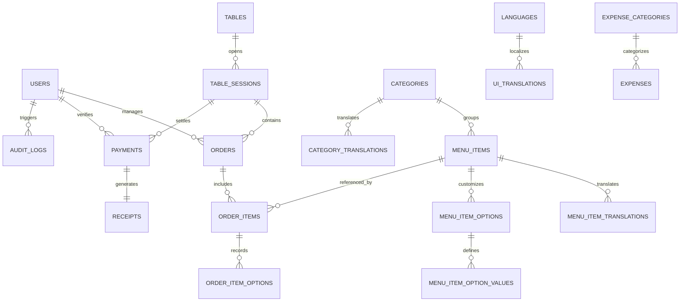

# DineEasy Database Entity Relationship Diagram (ERD)

## Core Relationships
- `categories` 1 : N `menu_items`
- `menu_items` 1 : N `menu_item_translations`
- `menu_items` 1 : N `menu_item_options` 1 : N `menu_item_option_values`
- `tables` 1 : N `table_sessions`
- `table_sessions` 1 : N `orders`
- `table_sessions` 1 : N `payments` 1 : 1 `receipts`
- `orders` 1 : N `order_items` 1 : N `order_item_options`
- `users` 1 : N `orders` (confirming/serving staff) & 1 : N `payments` (verifying staff)
- `languages` 1 : N `ui_translations`
- `expense_categories` 1 : N `expenses`

See `/database/schema.sql` for the complete MySQL 8 / MariaDB DDL and `/server/db.ts` for the live SQLite schema.
